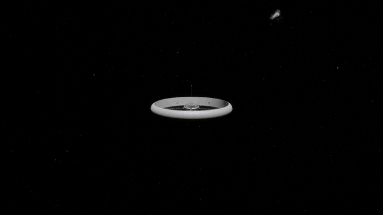
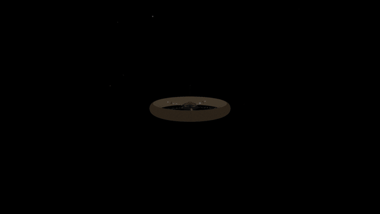
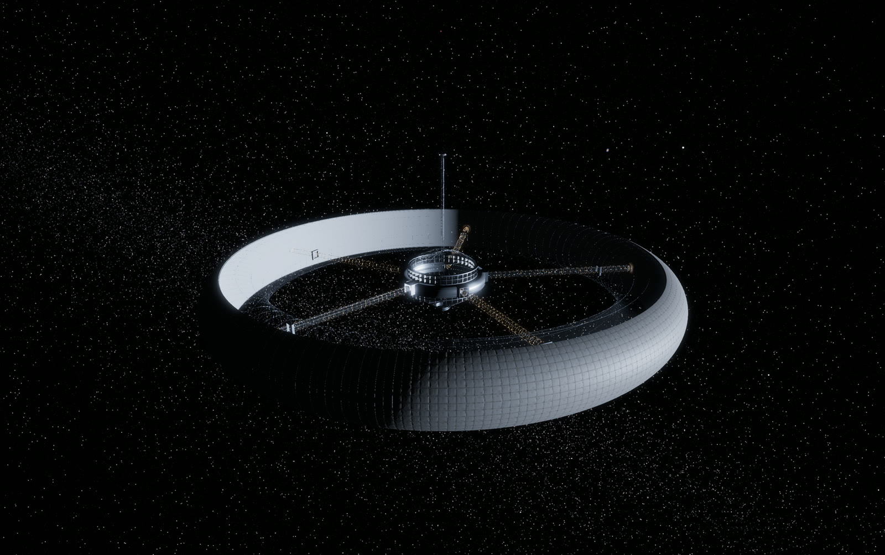

# rust-universe-map

**저장된 우주가 아니라, 계산되는 우주 지도.**
A map of the universe that is computed, not stored. (English summary at the bottom.)



*안드로메다 은하로 들어가 그 안의 별에 도착하기까지 (29초, [MP4](docs/milky-way-to-andromeda.mp4)). 가까워지면서 보이는 점들은 그 자리에서 계산된 안드로메다의 별입니다.*



*우리 은하 밖에서 지구까지 (1분, [MP4](docs/outside-milky-way-to-earth.mp4)).*


*지구를 떠나 목성에 도착하기까지 (1분, [MP4](docs/earth-to-jupiter.mp4)). 행성의 위치는 그 날짜의 실제 위치(VSOP87)입니다.*



*안드로메다 은하 1번 별(`Andromeda Galaxy/1`, 254만 광년)에 도착한 모습. 배경은 사진이 아니라 안드로메다의 계산된 별들이고, 우주선을 비추는 푸른 빛은 그 B9형 별의 빛입니다.*

> 위 영상과 그림의 우주선, 행성 그림, 3인칭 카메라는 이 지도를 쓰는 별도의 게임에서 찍은 것입니다.
> 이 저장소에는 **지도만** 있습니다. 게임 엔진, 렌더러, 우주선 모델은 들어 있지 않습니다.

## 이것이 무엇인가

안드로메다 은하는 여기서 그림 한 장이 아닙니다. **7,500억 개의 항성계**, 동반성까지 세면 약 1조 개의 별로 이루어져 있고, 별마다 주소가 있습니다. 그런데 그 별들은 어디에도 저장되어 있지 않습니다.

- 은하의 모양은 수식과 작은 행렬로 적혀 있습니다 (은하 하나에 숫자 약 4 KB).
- 우리 은하, 안드로메다를 비롯한 은하 18개는 수식이 아니라 **X, Y, Z 세 축에서 본 그림 세 장**으로 적혀 있습니다. 세 그림이 겹치는 곳의 밝기가 그 자리의 별의 밀도입니다 (안드로메다는 그림 약 2 MB, 빛과 먼지 격자까지 합쳐 약 7.5 MB).
- 별은 **주소에서 계산됩니다.** `Andromeda Galaxy/123456789012/2`는 안드로메다의 123,456,789,012번째 별의 두 번째 행성이고, 누가 어느 컴퓨터에서 계산해도 같은 별, 같은 행성이 나옵니다.
- 별의 종류, 동반성, 행성의 개수와 크기와 궤도는 실제 관측 통계를 따릅니다 (출처는 [`map/SOURCES.md`](map/SOURCES.md)).

| | 값 |
|---|---|
| 별을 가진 은하 | 94개 (세 그림으로 적힌 은하 18개, 나머지는 수식) |
| 항성계 전체 | 약 1.15 × 10¹³ 개 |
| 우리 은하 | 2,695억 항성계 (별 약 3,650억 개) |
| 안드로메다 | 7,500억 항성계 (별 약 1조 개) |
| 지도 전체 용량 | 251 MB (그중 81 MB는 지구 고도, 42 MB는 지구 하늘을 맞추는 격자) |
| 안드로메다에 쓰인 용량 | 약 7.5 MB |
| 별 하나를 주소에서 계산하는 시간 | 0.006 ms ~ 약 1 ms |

안드로메다의 별 1조 개를 별마다 20바이트로 저장했다면 약 20 TB가 필요합니다. 여기서는 7.5 MB입니다.

## 이 프로젝트가 어떻게 시작되었나

저는 천문학을 모릅니다. 이 지도는 인터넷에 공개되어 있는 [Gaia Sky](https://codeberg.org/gaiasky/gaiasky)의 소스와 데이터에서 출발했습니다. 거기 있는 은하 사진들을 계산해서 은하마다 수식(밝기 분포, 나선팔, 먼지 띠, 두께)을 만들었고, 그 수식에서 별을 만들었습니다.

그래서 이 지도에는 틀린 곳이 많을 것입니다. 저 혼자서는 그것을 알아볼 수도 고칠 수도 없습니다. 천문학을 아는 사람, 데이터를 다루는 사람, 코드를 쓰는 사람이 서로 도와서 **정말로 우주의 지도라고 부를 수 있는 것**을 함께 만들고 싶어서 공개합니다. 고칠 곳을 알려 주시는 것만으로도 큰 도움이 됩니다.

## 무엇이 실제이고 무엇이 계산인가

정직하게 나누면 이렇습니다.

| 층 | 근거 |
|---|---|
| 태양 주변 먼지 (69 pc ~ 1.25 kpc) | **측정**: Edenhofer et al. 2023 |
| 지구의 고도 | **측정**: NOAA ETOPO 2022 |
| 태양 근처의 별, 태양계 (선택 사항) | **측정**: Gaia DR3 등, Gaia Sky 데이터가 설치되어 있을 때만 |
| 세 그림으로 적힌 은하 18개 (우리 은하, 안드로메다, 마젤란 은하들, M33, M51, M81, M101 등) | 세 축(X 긴 축, Y 극, Z 짧은 축)에서 본 그림 세 장. 정면 그림은 사진을 펴서 만들거나 이미지 모델이 그린 것이고, 옆에서 본 두 장은 이미지 모델이 그린 것. 사진이 있는 은하는 지구에서 본 모습이 사진과 닮도록 맞춤. 우리 은하는 밖에서 찍은 사진이 없으므로 전부 상상도 |
| 우리 은하의 빛과 먼지 격자 | R. Hurt의 상상도(측정된 막대, 나선팔, 태양 위치로 그린 그림)에서 계산 |
| 사진이 없는 은하 | 위치와 크기만 카탈로그의 것. 모양은 이미지 모델이 만든 그림에서 계산 |
| 개별 별, 동반성, 행성 | **전부 계산**. 실제 별이 아니라 실제 별의 통계를 따르는 별 |
| 블랙홀, 중성자별 등 | 은하 전체의 추정 개수에서 계산 |

다른 은하의 별은 태양 근처 별의 밝기 분포를 그대로 씁니다. 별마다 측정된 곳이 거기뿐이기 때문입니다.

## 바로 해 보기

Rust만 있으면 됩니다. 다른 데이터는 필요 없습니다.

```
git clone https://github.com/you6878/rust-universe-map
cd rust-universe-map
cargo run --release --example address -- "Andromeda Galaxy/1"
cargo run --release --example address -- "Andromeda Galaxy/123456789012/2"
cargo run --release --example address -- "Milky Way/280"
```

```
Andromeda Galaxy/1  (computed in 0.007 ms)
  2537496 light years from the Sun
  star: B9 V, 2.37 solar masses, 2.31 solar radii, 10152 K, 40.93 times the Sun's light
  planets: 7
    1: sub-Neptune: 9.31 Earth masses, 2.59 Earth radii, 0.101 AU from star 1, once in 7.7 days, 2140 K, 2 moons
    ...
    7: rocky planet: 4.62 Earth masses, 1.51 Earth radii, 5.539 AU from star 1, once in 8.5 years, 290 K, 1 moon
```

## 메모리와 용량

Gaia Sky 본체는 Java로 되어 있고(Python은 스크립트와 도구에 쓰입니다), 이 지도의 코드는 Rust입니다. **두 프로그램의 메모리를 나란히 재 본 적은 없으므로 "몇 % 절약"이라는 숫자는 적지 않습니다.** 아래는 이 코드에서 직접 잰 값입니다 (Apple Silicon, release 빌드).

| 무엇을 | 메모리 |
|---|---|
| 주소 하나 계산 (`examples/address`, 지도 전체를 읽음) | 최대 677 MB |
| 지도를 쓰는 렌더러, 지구 근처 (Gaia 별 646,401개 포함) | 476 MB |
| 같은 렌더러, 은하 중심 근처 (계산된 별 724,471개가 보이는 곳) | 1,242 MB |

절약되는 것은 메모리보다 **저장 공간**입니다. 카메라 주변의 별만 그 순간 계산해서 가지고 있고, 떠나면 버립니다. 은하 전체는 메모리에도 디스크에도 없습니다. 주소 하나를 계산하는 데 677 MB가 드는 것은 지도의 격자를 모두 읽기 때문이고, 줄일 수 있는 부분입니다 (아래 "도움이 필요한 곳").

## 주소

우편 주소처럼 큰 곳에서 작은 곳으로 갑니다: `은하/별/행성`.

- `Andromeda Galaxy/1/2`: 안드로메다 1번 별의 두 번째 행성
- `Milky Way/280`: 우리 은하의 280번 별
- 별 번호는 1부터 그 은하의 항성계 수까지입니다. 1번은 은하 중심의 별입니다.
- 은하 이름은 한국어와 다른 이름으로도 찾습니다 (`안드로메다`, `M31`, `NGC 224`).

## 폴더

```
rust-universe-map/
  map/
    universe.json            지도 전체: 모든 층과 그 층을 이루는 파일 (Gaia Sky 데이터가 있을 때)
    universe-computed.json   다른 데이터 없이 동작하는 층만 (예제가 읽는 것)
    grids/                   빛과 먼지의 복셀 격자, 지구 고도
    galaxies/                은하의 수식 (fitted.json, imagined.json)과 정면 행렬, 은하별 세 그림 (*_xyz*)
    SOURCES.md               통계 수치의 출처
    preview/                 결과 그림
  core/                      Rust 크레이트 universe-map (엔진, 렌더러 없음)
    src/map.rs                 지도 읽기
    src/places.rs              주소로 별과 행성 찾기
    src/procedural.rs          공간을 정육면체로 나눠 그 좌표에서 별을 계산
    src/stars.rs               밝기에서 분광형, 질량, 크기, 온도
    src/systems.rs             동반성과 케플러 궤도
    src/planets.rs             행성의 수, 크기, 간격, 종류
    src/rare.rs                중성자별, 블랙홀, 갈색왜성 등
    src/fitted.rs              은하의 수식에서 별 만들기
    src/photo_volume.rs        세 축의 그림에서 별 만들기
    src/ground.rs              행성의 지형
    src/astro.rs, vsop87.rs, bodies.rs   태양계 (Gaia Sky 데이터가 있을 때)
    src/travel.rs, journey.rs  이름으로 찾기, 그곳까지 가는 길
    src/survey.rs              SDSS 은하 탐사의 은하들 (Gaia Sky 데이터가 있을 때)
    examples/address.rs        주소에 무엇이 있는지 출력
  starmap/                   Gaia Sky 별 카탈로그(particles_*.bin) 리더
  tools/                     격자와 은하 수식을 만드는 Python 도구
```

## 개발자가 알아야 할 것

**빌드와 테스트.** `cargo build --release`, `cargo test --release` (85개 통과). 일부 테스트는 Gaia Sky 데이터(`~/.gaiasky/data`)가 없으면 건너뜁니다.

**단위와 좌표.** 은하 좌표는 파섹, 태양이 원점, +Z가 은하 중심, +Y가 은하 북극, +X가 은경 90°입니다. 적도 좌표(내부)는 +Z가 춘분점, +X가 적경 90°, +Y가 북쪽입니다. 둘 사이의 변환은 `places::galactic_to_equatorial()`입니다. 항성계 안에서는 AU, 날짜는 J2000부터의 일수입니다.

**결정성.** 별은 은하와 번호(또는 정육면체 좌표와 순번)만으로 정해집니다. 난수는 그 값에서 씨앗을 얻으므로 같은 주소는 언제나 같은 별입니다. **별을 만드는 코드나 지도의 숫자를 바꾸면 모든 주소의 별이 달라집니다.** 주소를 공유하는 사람들이 있다면 이런 변경은 지도의 판을 올리는 일입니다. 아직 판 번호 체계는 없습니다.

**지도 형식.** `map/universe.json`의 각 블록에 `about`으로 설명이 적혀 있습니다. 복셀 격자는 gzip된 RGBA 바이트(RGB 색, A 밀도)이고 세 번째 축이 가장 빨리 돕니다. 옆의 metadata 파일에 `Grid size: WxHxD`와 `Volume bounds`가 있습니다. 은하를 하나 더하려면 `tools/galaxy_fit.py`로 사진에서 수식을 만들어 `map/galaxies/fitted.json`에 넣거나, `tools/galaxy_xyz.py`로 세 축의 그림을 만들어 `starField.galaxies`에 `photo`로 적습니다. `tools/galaxy_probe.py`는 세 그림의 한 지점에 어떤 별이 생기는지 보여 주는 페이지를 만듭니다. 코드는 고치지 않습니다.

**도구.** `tools/`는 Python이고 numpy, scipy, pillow가 필요합니다 (`match_panorama.py`는 healpy도). 측정된 먼지 지도 원본은 3.25 GB라 `fetch_shells.sh`로 따로 받습니다.

**Gaia Sky 데이터.** `map/universe.json`의 `stars`, `bodies`, `pictures`는 `~/.gaiasky/data`를 가리킵니다 (Gaia DR3 카탈로그, 행성 정의, VSOP87, 지구 큐브맵, 은하와 성운 카탈로그). Gaia Sky를 설치해 데이터를 받으면 이 층들이 켜집니다. 없으면 `universe-computed.json`을 쓰면 됩니다. 이 저장소에는 그 데이터가 들어 있지 않습니다.

**그리는 것은 여러분 몫입니다.** 이 크레이트는 아무것도 그리지 않습니다. 카메라 주변의 별은 `procedural::Field`가, 은하의 별은 `fitted`가 위치, 절대등급, 색으로 줍니다. wgpu, Bevy, Godot, 웹 어디에든 붙일 수 있습니다.

## 도움이 필요한 곳

- **천문학**: 은하의 별 수, 두께, 팽대부, 밝기 분포가 맞는지. 다른 은하에 태양 근처의 별 분포를 쓰는 것이 얼마나 틀린지. `map/SOURCES.md`에서 "not verified"라고 적힌 수치들.
- **은하**: 더 많은 은하, 더 나은 사진, 타원은하와 불규칙은하의 모양 (지금 수식은 원반 은하용입니다).
- **실제 측정으로 바꾸기**: 계산된 별 자리에 실제 카탈로그(Gaia, 외계행성 목록)를 더 넓게 쓰는 것.
- **코드**: 주소 하나에 지도 전체를 읽지 않게 하기(677 MB), 지도 판 번호, WebAssembly, 다른 언어 바인딩.
- **검증**: 계산된 은하를 지구에서 본 모습과 실제 사진의 비교를 더 많은 은하로.

## 라이선스와 출처

코드는 [MPL-2.0](LICENSE.md)입니다. Gaia Sky(MPL-2.0, Toni Sagristà Sellés와 기여자들)의 코드를 Rust로 옮긴 부분(`starmap`, `vsop87.rs`, `bodies.rs` 등)이 들어 있습니다.

지도의 데이터는 다음에서 만들어졌습니다.

- 우리 은하 격자: R. Hurt의 정면 상상도 (NASA/JPL-Caltech/ESO), https://www.eso.org/public/images/eso1339g/
- 태양 주변 먼지: Edenhofer et al. 2023, https://doi.org/10.5281/zenodo.8187943, CC BY 4.0
- 지구 고도: NOAA NCEI, ETOPO 2022, doi:10.25921/fd45-gt74
- 지구의 하늘 격자(`sky_*`), 안드로메다 격자, 은하들의 정면 그림과 수식: Gaia Sky가 데이터로 배포하는 은하수 파노라마와 은하 사진(`catalog-nbg/tex/extragal`)에서 계산한 것입니다. 그 사진들 각각의 원저작자와 라이선스는 확인하지 못했습니다. 권리를 가진 분이 알려 주시면 표기하거나 내리겠습니다.
- 옆에서 본 그림과 사진이 없는 은하의 그림: 이미지 생성 모델이 그린 것
- 은하의 위치와 크기: Gaia Sky의 `catalog-nbg`
- 별, 동반성, 행성의 통계: [`map/SOURCES.md`](map/SOURCES.md)

## English summary

rust-universe-map is a map of the universe in which nothing is stored star by star. A galaxy is a formula and a few small matrices (for 18 galaxies, the Milky Way and Andromeda among them: three pictures, one seen along each axis); a star, its companions and its planets are computed from an address such as `Andromeda Galaxy/123456789012/2`, and the same address gives the same star on every machine. Andromeda has 750 billion star systems (about a trillion stars) in about 7.5 MB; the whole map, 94 galaxies and about 1.15 × 10¹³ systems, is 251 MB.

This repository is the map only: data, the Rust code that reads and computes it, and the Python tools that made it. There is no game engine and no renderer. The clips and the picture above were taken in a separate game that uses this map.

I am not an astronomer. This started from the public source and data of [Gaia Sky](https://codeberg.org/gaiasky/gaiasky): I computed formulas of galaxies from its pictures and made the stars from the formulas. Much of it is surely wrong in ways I cannot see. I am opening it so that people who know astronomy, data and code can help each other make something that deserves to be called a map of the universe.

The individual stars and planets are not real ones: they follow the statistics of real ones (sources in `map/SOURCES.md`). What is measured, what is fitted from pictures and what is imagined is listed in the table above.
