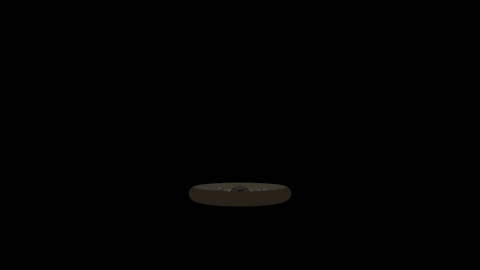
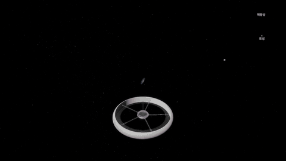
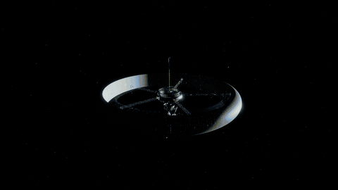

# rust-universe-map

**A map of the universe that is computed, not stored.**

**Play it: [Lull Space](https://lull-space.vercel.app)**, a quiet game built on this map. Board a ship with other people and travel the universe together, in your browser.



*From 5 billion light years out, where the surveyed galaxies look like a bubble around us, to Andromeda, then into the Milky Way and home to the Earth (1 min, [MP4](docs/bubble-to-earth.mp4)).*



*From the station over the Earth to the Andromeda galaxy and on to the star at its centre (1 min, [MP4](docs/earth-to-andromeda-star.mp4)). The points that fill the view at the end are Andromeda's stars, computed on the spot.*



*From the station in Earth orbit down through the air to the ground (1 min, the flight shown about 1.6 times faster, [MP4](docs/station-to-ground.mp4)). The landing site is Anbandegi, a ridge in Gangwon, Korea.*

In all three the camera is behind the ship and looks the way it is going.

## The game: Lull Space

**https://lull-space.vercel.app**

Lull Space is a real game made with this map, and a quiet one. There is nothing to fight and nothing to win. You pick a name, board a ring ship with whoever else is there, and go on a group trip through space: to Jupiter, out of the Milky Way, into Andromeda. The stars you pass on the way are the ones this map computes.

The clips above were taken in the game. The ship, the camera and everything that draws are the game's and are not in this repository, which holds **the map only**: no game engine, no renderer, no ship model.

It runs in the browser with nothing to install. The first visit downloads the game and its data (about 200 MB), so give it a moment.

## What this is

Andromeda is not one picture here. It is **750 billion star systems**, about a trillion stars with their companions, and every star has an address. None of those stars is stored anywhere.

- A galaxy's shape is a formula and a few small matrices (about 4 KB of numbers a galaxy).
- Eighteen galaxies, the Milky Way and Andromeda among them, are not formulas but **three pictures, one seen along each of the axes X, Y and Z**. Where the three pictures overlap, their brightness is the density of stars there (Andromeda: about 2 MB of pictures, about 7.5 MB with its grids of light and dust).
- A star is **computed from its address**. `Andromeda Galaxy/123456789012/2` is the second planet of the 123,456,789,012th star of Andromeda, and it is the same star and the same planet whoever computes it, on whatever machine.
- The kinds of stars, their companions, and the number, sizes and orbits of their planets follow the statistics of real surveys (sources in [`map/SOURCES.md`](map/SOURCES.md)).

| | |
|---|---|
| Galaxies with stars of their own | 94 (18 as three pictures, the rest as formulas) |
| Galaxies that can be made from their code | 327,835 (the SDSS DR12 list, see below) |
| Star systems in all | about 1.15 × 10¹³ |
| The Milky Way | 269.5 billion star systems (about 365 billion stars) |
| Andromeda | 750 billion star systems (about a trillion stars) |
| The whole map | 251 MB (81 MB of it is the Earth's heights, 42 MB the grids that match the Earth's sky) |
| Andromeda's share | about 7.5 MB |
| Computing one star from its address | 0.006 ms to about 1 ms |

A trillion stars of Andromeda at 20 bytes a star would be about 20 TB. Here it is 7.5 MB.

## A galaxy as a code: the "latent vector"

A generative model does not keep its pictures. It keeps a short list of numbers, a latent vector, and decodes a picture from it when asked. This map treats the galaxies it has not visited the same way, and that is why it stays between 200 and 300 MB.

A galaxy that nobody has gone to yet is **a code of a few numbers**: where it is and its redshift (what the survey measured), and what follows from its catalogue number as a seed: its kind (spiral, elliptical, irregular, giant elliptical), its size, its light, how round and how thick it is, and how it is turned in space. In the survey's file that is 36 bytes a galaxy. It is not a vector an LLM learned: the name is an analogy, and what decodes it is an image model.

```
code (36 bytes)  ->  three prompts: from above, and from two sides
                 ->  an image model draws the three views (X, Y, Z)
                 ->  xyz_make puts them on one grid
                 ->  the stars are computed where the three views overlap
```

**How many galaxies.** Today the list is the SDSS DR12 catalogue that Gaia Sky distributes: **327,835 galaxies in 11.8 MB**, each one a place you can name (`SDSS 75`) and have made. Each comes out as a galaxy of its own, with its own kind, size, colours, shape and orientation, and three pictures drawn for it alone. Nothing in the method stops at that list: any galaxy with a position and a redshift can be a code, so the same map can grow toward every galaxy that has been observed. What grows is the list, not the stars: 36 bytes a galaxy means about 7 million galaxies in the size of today's map, and a catalogue of hundreds of millions would be gigabytes and would have to be shipped apart from it.

**What it costs to make one.** Making a galaxy does **not** generate its hundreds of billions of stars. It asks an image model for three small pictures, once. Measured for `SDSS 75` (a spiral 347 million light years away, about 2.8 × 10¹¹ stars), with OpenAI's `gpt-image-2` at low quality:

| | |
|---|---|
| Pictures | 3 (the view from above at 2048 px, two side views at 1024 px) |
| Tokens the model wrote | 789 (397 + 196 + 196) |
| Tokens in all, with the prompts and the top view given back as input | about 4,200 |
| Time | about a minute |
| Kept on disk afterwards | about 3.5 MB (11 MB with the model's original pictures) |

After that the galaxy costs nothing more. Its stars are computed from their addresses only around the camera, as in Andromeda, and are thrown away when you leave. What that many tokens cost in money depends on your image model and its prices at the time.

**What is honest to say about it.**

- The same number always gives the same code. The pictures an image model draws from a code are not the same twice, so a galaxy made once has to be kept and shared, not made again.
- The SDSS file gives only where each galaxy is. Its kind, size and brightness are drawn from its seed in the proportions seen in the local universe (beyond redshift 0.35, giant ellipticals, as SDSS chose its targets). They are not measurements of that galaxy.
- This crate asks no image model itself. It gives the code and the prompts and makes the galaxy from the three pictures you bring. `tools/galaxy_gpt.py` is one way to get them.
- The SDSS list is not in this repository. It comes with Gaia Sky's data (`catalog-sdss-12`).

```
cargo run --release --example galaxy_code -- "SDSS 75"
cargo run --release --example galaxy_code -- "SDSS 75" path/to/sdss_dr12.bin pictures/
```

The first prints the code and the three prompts. The second, given a folder with `y.png`, `x.png` and `z.png`, makes the galaxy there.

## How this started

I am not an astronomer. This map started from the public source and data of [Gaia Sky](https://codeberg.org/gaiasky/gaiasky). I computed a formula for each galaxy (its light profile, spiral arms, dust lanes, thickness) from the galaxy pictures found there, and made the stars from the formulas.

So much of this map is surely wrong, in ways I can neither see nor fix alone. I am opening it because I would like people who know astronomy, people who work with data and people who write code to help each other make **something that deserves to be called a map of the universe**. Simply telling me what is wrong is already a great help.

## What is real and what is computed

| Layer | Where it comes from |
|---|---|
| Dust around the Sun (69 pc to 1.25 kpc) | **Measured**: Edenhofer et al. 2023 |
| The Earth's heights | **Measured**: NOAA ETOPO 2022 |
| Stars near the Sun, the Solar System (optional) | **Measured**: Gaia DR3 and others, only when Gaia Sky's data is installed |
| The 18 galaxies of three pictures (the Milky Way, Andromeda, the Magellanic Clouds, M33, M51, M81, M101 and others) | Three pictures seen along three axes (X the long axis, Y the pole, Z the short axis). The face-on one is the photograph unrolled or drawn by an image model, the two side views are drawn by an image model. Where there is a photograph, the galaxy is fitted so that it looks like the photograph when seen from the Earth. There is no photograph of the Milky Way from outside, so all of it is imagined |
| The Milky Way's grids of light and dust | Computed from R. Hurt's artist's impression (drawn from the measured bar, arms and place of the Sun) |
| Galaxies without a photograph | Only their place and size are the catalogue's. Their shape is computed from pictures drawn by an image model |
| Galaxies made from their code (SDSS) | Their place and redshift are the survey's. Kind, size and light are drawn from the seed, the pictures by an image model |
| Single stars, companions, planets | **All computed**. Not real stars, but stars that follow the statistics of real ones |
| Black holes, neutron stars and the like | Computed from estimates of how many a whole galaxy has |

The stars of other galaxies use the brightness distribution of the stars near the Sun, because that is the only place where stars have been measured one by one.

## Try it

You need Rust and nothing else. No other data is needed for these.

```
git clone https://github.com/you6878/rust-universe-map
cd rust-universe-map
cargo run --release --example address -- "Andromeda Galaxy/1"
cargo run --release --example address -- "Andromeda Galaxy/123456789012/2"
cargo run --release --example address -- "Milky Way/280"
```

```
Andromeda Galaxy/1  (computed in 0.007 ms)
  2537496 light years from the Sun
  star: B9 V, 2.37 solar masses, 2.31 solar radii, 10152 K, 40.93 times the Sun's light
  planets: 7
    1: sub-Neptune: 9.31 Earth masses, 2.59 Earth radii, 0.101 AU from star 1, once in 7.7 days, 2140 K, 2 moons
    ...
    7: rocky planet: 4.62 Earth masses, 1.51 Earth radii, 5.539 AU from star 1, once in 8.5 years, 290 K, 1 moon
```

## Memory and size

Gaia Sky itself is written in Java (Python is used for its scripts and tools), and this map's code is Rust. **The two programs have never been measured side by side, so no "saves so many percent" is claimed here.** These are measured with this code (Apple Silicon, release build).

| What | Memory |
|---|---|
| Computing one address (`examples/address`, which reads the whole map) | 677 MB at most |
| A renderer using the map, near the Earth (with 646,401 Gaia stars) | 476 MB |
| The same renderer near a galaxy's centre (724,471 computed stars in view) | 1,242 MB |

What is saved is **storage** more than memory. Only the stars around the camera are computed and held, and they are dropped when you leave. A whole galaxy is neither in memory nor on disk. One address takes 677 MB because all the map's grids are read, which can be reduced (see "Where help is needed").

## Addresses

Like a postal address, from the large to the small: `galaxy/star/planet`.

- `Andromeda Galaxy/1/2`: the second planet of star 1 of Andromeda
- `Milky Way/280`: star 280 of the Milky Way
- Star numbers go from 1 to the number of star systems of the galaxy. Star 1 is the star at its centre.
- A galaxy is also found by its Korean name and its other names (`안드로메다`, `M31`, `NGC 224`).

## Folders

```
rust-universe-map/
  map/
    universe.json            the whole map: every layer and its files (with Gaia Sky's data)
    universe-computed.json   only the layers that work without other data (what the examples read)
    grids/                   voxel grids of light and dust, the Earth's heights
    galaxies/                the galaxies' formulas (fitted.json, imagined.json), their face-on
                             matrices, and the three pictures of each (*_xyz*)
    SOURCES.md               where the statistics come from
    preview/                 pictures of the results
  core/                      the Rust crate universe-map (no engine, no renderer)
    src/map.rs                 reads the map
    src/places.rs              finds a star and a planet by address
    src/procedural.rs          divides space into cubes and computes the stars of each
    src/stars.rs               from brightness to spectral type, mass, size, temperature
    src/systems.rs             companions and Kepler orbits
    src/planets.rs             how many planets, their sizes, spacing and kinds
    src/rare.rs                neutron stars, black holes, brown dwarfs and the like
    src/fitted.rs              stars from a galaxy's formula
    src/photo_volume.rs        stars from the pictures along three axes
    src/galaxy_code.rs         a galaxy as its code, and the prompts it is drawn from
    src/xyz_make.rs            a galaxy made from the three pictures drawn from its code
    src/survey.rs              the galaxies of the SDSS survey (with Gaia Sky's data)
    src/ground.rs              a planet's ground
    src/astro.rs, vsop87.rs, bodies.rs   the Solar System (with Gaia Sky's data)
    src/travel.rs, journey.rs  finding a place by name, the way there
    examples/address.rs        prints what is at an address
    examples/galaxy_code.rs    prints a galaxy's code, and makes it from its pictures
  starmap/                   reader of Gaia Sky's star catalogue (particles_*.bin)
  tools/                     the Python tools that made the grids and the formulas
```

## What a developer needs to know

**Build and test.** `cargo build --release`, `cargo test --release` (92 pass). Some tests are skipped without Gaia Sky's data (`~/.gaiasky/data`).

**Units and axes.** Galactic coordinates are in parsecs with the Sun at the origin, +Z toward the galactic centre, +Y toward the galactic north pole, +X toward galactic longitude 90°. Equatorial (internal) axes have +Z toward the vernal equinox, +X toward right ascension 90°, +Y north. `places::galactic_to_equatorial()` turns one into the other. Inside a star system lengths are in AU, and dates are days since J2000.

**Determinism.** A star is set by its galaxy and its number alone (or by its cube's coordinates and its index). The random numbers take their seed from those, so the same address is always the same star. **Changing the code that makes the stars, or the numbers of the map, changes the star at every address.** If people share addresses, such a change is a new edition of the map. There is no edition numbering yet.

**The map's format.** Every block of `map/universe.json` says what it is in its `about`. A voxel grid is gzipped RGBA bytes (RGB colour, A density) with the third axis running fastest. The metadata file next to it has `Grid size: WxHxD` and `Volume bounds`. To add a galaxy, make its formula from a photograph with `tools/galaxy_fit.py` and put it in `map/galaxies/fitted.json`, or make the pictures along three axes with `tools/galaxy_xyz.py` and enter it in `starField.galaxies` as a `photo`. `tools/galaxy_probe.py` makes a page that shows which stars come out at a point of the three pictures. No code has to change.

**Tools.** `tools/` is Python and needs numpy, scipy and pillow (`match_panorama.py` also healpy). The original of the measured dust map is 3.25 GB and is fetched apart with `fetch_shells.sh`. `galaxy_gpt.py` asks OpenAI's image model for a galaxy's three pictures. It reads the key from the environment, never prints it, and has a `--dry-run` that asks nothing.

**Gaia Sky's data.** `stars`, `bodies` and `pictures` in `map/universe.json` point to `~/.gaiasky/data` (the Gaia DR3 catalogue, the planets' definitions, VSOP87, the Earth's cubemaps, the catalogues of galaxies and nebulae, the SDSS list). Installing Gaia Sky and downloading its data turns those layers on. Without it, use `universe-computed.json`. That data is not in this repository.

**Drawing is up to you.** This crate draws nothing. `procedural::Field` gives the stars around the camera and `fitted` the stars of a galaxy, as positions, absolute magnitudes and colours. They can be fed to wgpu, Bevy, Godot or the web.

## Where help is needed

- **Astronomy**: whether the galaxies' star counts, thickness, bulges and light profiles are right. How wrong it is to use the Sun's neighbourhood for the stars of other galaxies. The numbers marked "not verified" in `map/SOURCES.md`.
- **Galaxies**: more galaxies, better photographs, the shapes of elliptical and irregular galaxies (the formulas are for disc galaxies). Measured kinds and sizes for the SDSS galaxies in place of the ones drawn from a seed.
- **Replacing computed by measured**: using real catalogues (Gaia, the lists of exoplanets) more widely where stars are now computed.
- **Code**: not reading the whole map for one address (677 MB), edition numbers for the map, WebAssembly, bindings for other languages.
- **Checking**: comparing more computed galaxies, seen from the Earth, with their real photographs.

## Licence and sources

The code is under [MPL-2.0](LICENSE.md). It contains parts of Gaia Sky (MPL-2.0, Toni Sagristà Sellés and contributors) ported to Rust (`starmap`, `vsop87.rs`, `bodies.rs` and others).

The map's data was made from the following.

- The Milky Way's grids: R. Hurt's face-on artist's impression (NASA/JPL-Caltech/ESO), https://www.eso.org/public/images/eso1339g/
- Dust around the Sun: Edenhofer et al. 2023, https://doi.org/10.5281/zenodo.8187943, CC BY 4.0
- The Earth's heights: NOAA NCEI, ETOPO 2022, doi:10.25921/fd45-gt74
- The grids of the Earth's sky (`sky_*`), Andromeda's grids, and the galaxies' face-on pictures and formulas: computed from the Milky Way panorama and the galaxy photographs that Gaia Sky distributes as data (`catalog-nbg/tex/extragal`). I could not establish the original author and licence of each of those photographs. If you hold rights in one, tell me and I will credit it or take it down.
- The side views, and the pictures of galaxies without a photograph: drawn by image generation models
- The galaxies' places and sizes: Gaia Sky's `catalog-nbg`
- The list of galaxies made from their code: SDSS DR12 as Gaia Sky distributes it (`catalog-sdss-12`, https://www.sdss.org/dr12), not included here
- The statistics of stars, companions and planets: [`map/SOURCES.md`](map/SOURCES.md)
